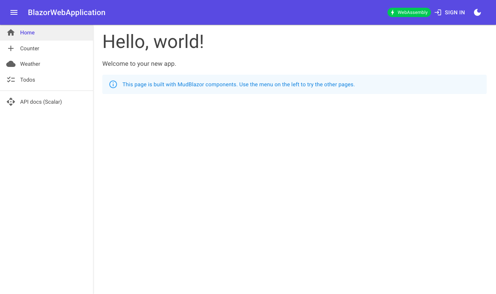

# Step 03 — Add MudBlazor

**What you'll do:** replace Bootstrap with [MudBlazor](https://mudblazor.com), a Material Design component library, and give the app a layout with an app bar and a side menu.

## Steps

1. Add the package to **both** the Server and the Client project:

   ```bash
   dotnet add src/BlazorWebApplication.Server package MudBlazor --version 9.14.0
   dotnet add src/BlazorWebApplication.Client package MudBlazor --version 9.14.0
   ```

2. Remove Bootstrap and the template's layout CSS:

   ```bash
   rm -r src/BlazorWebApplication.Server/wwwroot/lib
   rm src/BlazorWebApplication.Client/Layout/MainLayout.razor.css src/BlazorWebApplication.Client/Layout/NavMenu.razor.css
   ```

   Replace [app.css](../../src/BlazorWebApplication.Server/wwwroot/app.css) with a short version that only styles the error bar.

3. In the server's [App.razor](../../src/BlazorWebApplication.Server/Components/App.razor), swap the Bootstrap links
   for the MudBlazor font, CSS and script:

   ```razor
   <link rel="stylesheet" href="https://fonts.googleapis.com/css2?family=Roboto:ital,wght@0,100..900;1,100..900&display=swap" />
   <link rel="stylesheet" href="@Assets["_content/MudBlazor/MudBlazor.min.css"]" />
   <link rel="stylesheet" href="@Assets["app.css"]" />
   ...
   <script src="@Assets["_framework/blazor.web.js"]"></script>
   <script src="@Assets["_content/MudBlazor/MudBlazor.min.js"]"></script>
   ```

   Also remove the `BlazorWebApplication.Server.styles.css` link: there are no `.razor.css` files any more.

4. Register the MudBlazor services in **both** `Program.cs` files
   ([Server](../../src/BlazorWebApplication.Server/Program.cs), [Client](../../src/BlazorWebApplication.Client/Program.cs)):

   ```csharp
   using MudBlazor.Services;

   builder.Services.AddMudServices();
   ```

5. Add `@using MudBlazor` to both `_Imports.razor` files
   ([Client](../../src/BlazorWebApplication.Client/_Imports.razor), [Server](../../src/BlazorWebApplication.Server/Components/_Imports.razor)).

6. Rewrite the layout with MudBlazor components
   ([MainLayout.razor](../../src/BlazorWebApplication.Client/Layout/MainLayout.razor)). The key parts:

   ```razor
   <MudThemeProvider @bind-IsDarkMode="_isDarkMode" Theme="_theme" />
   <MudPopoverProvider />
   <MudDialogProvider />
   <MudSnackbarProvider />

   <MudLayout>
       <MudAppBar Elevation="1"> ... </MudAppBar>
       <MudDrawer @bind-Open="_drawerOpen" ClipMode="DrawerClipMode.Always" Variant="DrawerVariant.Responsive">
           <NavMenu />
       </MudDrawer>
       <MudMainContent>
           <MudContainer MaxWidth="MaxWidth.Large" Class="mt-4">@Body</MudContainer>
       </MudMainContent>
   </MudLayout>
   ```

   The app bar has a menu button (opens and closes the drawer) and a dark mode button.

7. Replace the menu with `MudNavMenu` ([NavMenu.razor](../../src/BlazorWebApplication.Client/Layout/NavMenu.razor)):

   ```razor
   <MudNavMenu>
       <MudNavLink Href="" Match="NavLinkMatch.All" Icon="@Icons.Material.Filled.Home">Home</MudNavLink>
       <MudNavLink Href="counter" Match="NavLinkMatch.Prefix" Icon="@Icons.Material.Filled.Add">Counter</MudNavLink>
       <MudNavLink Href="weather" Match="NavLinkMatch.Prefix" Icon="@Icons.Material.Filled.Cloud">Weather</MudNavLink>
   </MudNavMenu>
   ```

8. Convert the pages in `src/BlazorWebApplication.Client/Pages`:

   | Page | Before | After |
   |---|---|---|
   | [Home](../../src/BlazorWebApplication.Client/Pages/Home.razor) | `<h1>`, text | `MudText`, `MudAlert` |
   | [Counter](../../src/BlazorWebApplication.Client/Pages/Counter.razor) | `<button class="btn">` | `MudButton`, `MudChip` |
   | [Weather](../../src/BlazorWebApplication.Client/Pages/Weather.razor) | `<table class="table">` | `MudTable` with a loading bar |
   | [NotFound](../../src/BlazorWebApplication.Client/Pages/NotFound.razor) | `<h3>`, text | `MudText`, `MudButton` |

   Page titles use `<MudText Typo="Typo.h3" HtmlTag="h1">`: it looks like an `h3` but is still an `<h1>`,
   so `<FocusOnNavigate Selector="h1">` in `Routes.razor` keeps working.

9. The server's [Error.razor](../../src/BlazorWebApplication.Server/Components/Pages/Error.razor) used Bootstrap classes. Replace them with plain HTML.

## Check it works

```bash
dotnet build BlazorWebApplication.slnx
dotnet run --project src/BlazorWebApplication.Server --launch-profile https
```

Open <https://localhost:7029>. You see a blue app bar and a side menu. Try:



*The screenshots in this guide show the finished app (step 12), so you may see menu items that you add later.*


- **Counter**: the button adds to the number in the chip.
- **Weather**: click it in the menu. A loading bar shows, then a table.
  (If you reload the page, you may see the table, a short loading bar, then new numbers: the page was prerendered
  and then loaded again in the browser. Step 05 shows how to avoid this.)
- The menu button hides and shows the drawer. The moon button switches to dark mode.

## Why it works

MudBlazor components are normal Razor components. They come with their own CSS and a small JavaScript file,
which the app loads from `_content/MudBlazor/` (files that a NuGet package ships this way are called **static web assets**).

The pages live in the Client project, but they are also **prerendered** on the server.
That's why the server needs `AddMudServices()` too: without it, prerendering fails because services like `ISnackbar` are missing.

The four providers (theme, popover, dialog, snackbar) must run interactively.
In this app every page is interactive (`<Routes @rendermode="InteractiveWebAssembly" />`), so they can live in `MainLayout`.
