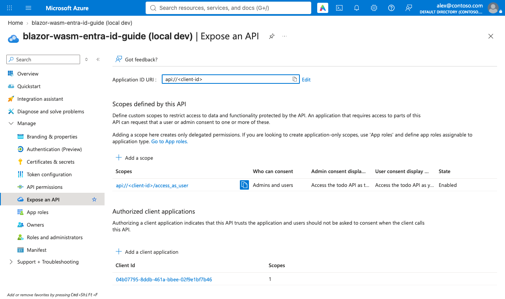
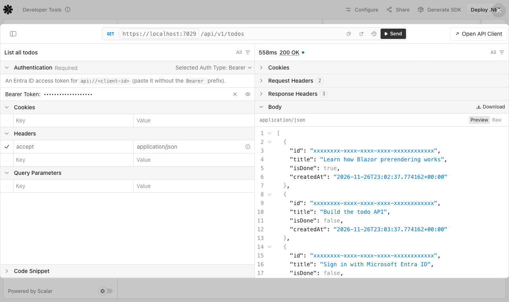

# Step 11 — Protect the external API with bearer tokens

**What you'll do:** make `/api/v1/todos` accept only Entra ID access tokens, expose a scope for it in Entra ID, get a token with the Azure CLI, and send it from Scalar.

## Steps

### Expose the API in Entra ID

1. Open **Microsoft Entra ID → App registrations → BlazorWebApplication → Expose an API**.
   Next to **Application ID URI**, click **Add**, keep the suggested value and click **Save**:

   | Field | Value |
   |---|---|
   | Application ID URI | `api://<client-id>` |

2. On the same page, click **Add a scope**:

   | Field | Value |
   |---|---|
   | Scope name | `access_as_user` |
   | Who can consent? | **Admins and users** |
   | Admin consent display name | `Access the todo API` |
   | Admin consent description | `Lets the app call the todo API as the signed-in user.` |
   | State | **Enabled** |

   

3. Still on **Expose an API**, under **Authorized client applications**, click **Add a client application**.
   This lets the Azure CLI ask for a token without a consent prompt:

   | Field | Value |
   |---|---|
   | Client ID | `04b07795-8ddb-461a-bbee-02f9e1bf7b46` (the Azure CLI, the same in every tenant) |
   | Authorized scopes | tick `api://<client-id>/access_as_user` |

4. (optional, recommended) Open **Manifest** and set `"requestedAccessTokenVersion": 2` inside `"api"`.
   Then click **Save**. The app accepts both token versions, but v2 tokens are easier to read.

5. Assign yourself the API roles. Open **Microsoft Entra ID → Enterprise applications → BlazorWebApplication → Users and groups → Add user/group**
   and add your account with **Api.Writer** (and once more with **Reader**, if you don't have it yet from step 09).
   `Contributor` is only for the web app; it doesn't work for `/api/v1`.

### Protect the API in the app

6. Add the bearer scheme next to the sign-in cookie in the server's [Program.cs](../../src/BlazorWebApplication.Server/Program.cs).
   It reuses the `AzureAd` settings, so there is nothing new to configure:

   ```csharp
   builder.Services.AddAuthentication()
       .AddMicrosoftIdentityWebApi(
           jwt =>
           {
               builder.Configuration.Bind("AzureAd", jwt);
               var clientId = builder.Configuration["AzureAd:ClientId"];
               jwt.TokenValidationParameters.ValidAudiences = [clientId, $"api://{clientId}"];
           },
           identity => builder.Configuration.Bind("AzureAd", identity),
           JwtBearerDefaults.AuthenticationScheme);
   ```

7. Add two policies to [Auth/Policies.cs](../../src/BlazorWebApplication.Server/Auth/Policies.cs).
   They accept only the `Bearer` scheme:

   ```csharp
   .AddPolicy(ApiRead, policy => policy
       .AddAuthenticationSchemes(JwtBearerDefaults.AuthenticationScheme)
       .RequireAuthenticatedUser()
       .RequireRole(AppRoles.Reader, AppRoles.ApiWriter)
       .RequireAssertion(context => UserTokenHasScope(context.User)))
   ```

   `ApiWrite` is the same with only `AppRoles.ApiWriter`.
   `UserTokenHasScope` returns `true` for a user token with `access_as_user`, and for an app token (which has no scopes).

8. Use them in [ExternalTodoEndpoints.cs](../../src/BlazorWebApplication.Server/Endpoints/ExternalTodoEndpoints.cs):

   ```csharp
   var group = app.MapGroup("/api/v1/todos")
       .WithTags("Todos")
       .RequireAuthorization(Policies.ApiRead);

   group.MapPost("/", TodoHandlers.Create)
       .WithName("CreateTodo")
       .RequireAuthorization(Policies.ApiWrite);
   ```

9. Tell the OpenAPI document about the token, so Scalar shows a field for it.
   Add [OpenApi/BearerSecuritySchemeTransformer.cs](../../src/BlazorWebApplication.Server/OpenApi/BearerSecuritySchemeTransformer.cs)
   and register it in [Program.cs](../../src/BlazorWebApplication.Server/Program.cs):

   ```csharp
   options.AddDocumentTransformer<BearerSecuritySchemeTransformer>();
   ...
   app.MapScalarApiReference(options => options
       .WithTitle("BlazorWebApplication API")
       .AddPreferredSecuritySchemes(BearerSecuritySchemeTransformer.SchemeId)
       .AddHttpAuthentication(BearerSecuritySchemeTransformer.SchemeId, scheme => scheme.WithToken(""))
       .EnablePersistentAuthentication());
   ```

   The sample requests in [BlazorWebApplication.Server.http](../../src/BlazorWebApplication.Server/BlazorWebApplication.Server.http)
   now send an `Authorization` header too.

## Check it works

1. Start the app:

   ```bash
   dotnet run --project src/BlazorWebApplication.Server --launch-profile https
   ```

2. Without a token you get `401`:

   ```bash
   curl -k -i https://localhost:7029/api/v1/todos
   ```

3. Get a token with the [Azure CLI](https://learn.microsoft.com/cli/azure/install-azure-cli):

   ```bash
   az login --tenant <tenant-id> --allow-no-subscriptions
   az account get-access-token --scope api://<client-id>/.default --query accessToken -o tsv
   ```

   `--allow-no-subscriptions` is needed when your tenant has no Azure subscription (for example a free or developer tenant).

4. Open **API docs (Scalar)**. Paste the token into the **Bearer Token** field, then send **List all todos**.

   | You have | List todos | Create a todo |
   |---|---|---|
   | no token | `401` | `401` |
   | a token, but no `Reader` or `Api.Writer` role | `403` | `403` |
   | `Reader` | `200` | `403` |
   | `Api.Writer` | `200` | `201` |

   

   

5. Signed in to the web app, open <https://localhost:7029/api/v1/todos> in the browser. You get `401`:
   the API ignores the sign-in cookie. The **Todos** page still works, because it uses `/api/ui`.

Roles are read when the token is made. After changing your roles, you need a fresh token.
Running `az account get-access-token` again is not enough: the Azure CLI returns its cached token (valid for about an hour) with the old roles.
Run `az logout`, then `az login --tenant <tenant-id> --allow-no-subscriptions`, or wait for the token to expire.
To see what is inside a token, paste it into <https://jwt.ms> (it is decoded in your browser).

## Why it works

An **access token** is a signed piece of JSON from Entra ID that says who may call which API.
The caller sends it in the header `Authorization: Bearer <token>`, which is why this is called a **bearer token**.
The API checks the signature, the issuer (your tenant) and the **audience** (`aud`): the token must be meant for this API.
Entra ID writes `aud` as `api://<client-id>` or as `<client-id>`, depending on the token version, so the app accepts both.

A **scope** (here `access_as_user`) is a permission that a user lets an app use on their behalf.
User tokens list their scopes in the `scp` claim. Tokens for an application acting as itself have no `scp`; they only have `roles`.
The policies need the right role in both cases, and the scope only when it is a user token. Step 12 shows both kinds.

The web app and the API share one app registration but use two **authentication schemes**: the cookie for pages and `/api/ui`, and `Bearer` for `/api/v1`.
Each policy names its scheme, so a cookie never counts on `/api/v1` and a token never counts on `/api/ui`.
That matters, because the browser sends cookies by itself, while a token must be added on purpose.

The Azure CLI is a separate app with a well-known client ID. Adding it under **Authorized client applications**
means your users don't have to consent to it before it can ask for tokens for your API.
